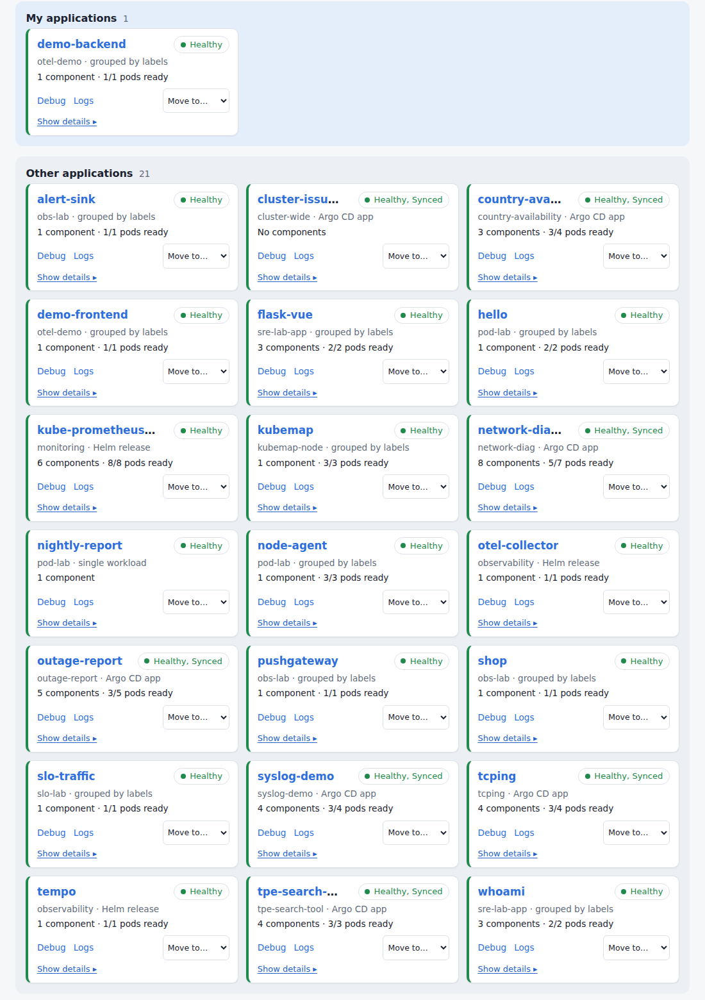
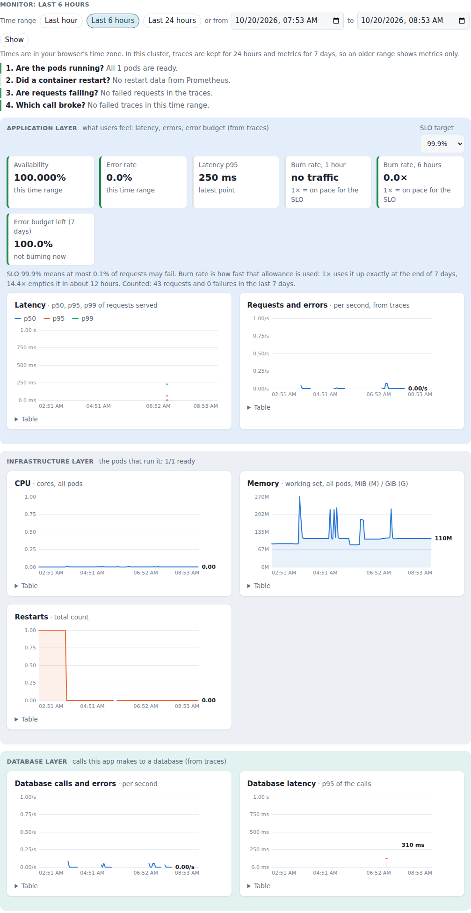
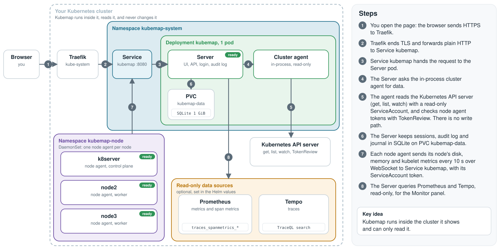

# Kubemap

**Live demo:** https://kubemap.albertycliu.xyz (login required, so see the screenshots below)

A read-only web portal that runs inside a Kubernetes cluster and shows it: which apps exist, how each one connects from its web address to its pods and database, how healthy each node is, and why a pod fails. It does not change anything in the cluster. It gives you the `kubectl` command that proves a problem and the fix, and you make the change yourself or in Git.

I built it as an SRE practice project. It watches my own 3-node K3s cluster.



## What it does

- **Application map:** each app from its route to its frontend, backend and database pods, found from IngressRoutes, Services, environment settings, ConfigMaps, Argo CD and Helm labels, and CNPG. You can drag your own apps into a "My applications" area; system namespaces get their own area.
- **Monitor panel per app, in three layers:** the application layer (availability, error rate, latency p95, error-budget burn rate and the budget left against an SLO you choose), the infrastructure layer (CPU, memory, restarts) and the database layer (calls, errors and latency from traces), plus the slowest and failed traces. Data comes from Prometheus span metrics and Tempo.
- **Node health:** a small agent on each node reports disk, inodes, memory, swap, pressure (PSI) and kubelet state. Kubemap tells "node down" from "agent down".
- **Problem finder and guided debugging:** known failure patterns (OOM kill, crash loop, exit 137, Pending, Service with no endpoints, disk near the eviction limit) and the checklist an SRE follows for a failing pod: status, events, previous logs, limits, node pressure, endpoints, NetworkPolicy.
- **NetworkPolicy checker and "who can do what" (RBAC):** can pod A reach pod B on a port, and which policy decides; which subject can do an action, and through which binding.
- **Practice material:** 28 SRE scenarios with live read-only checks, a namespace of apps that fail on purpose, and an incident journal with an interview (STAR) view.



## How it works



One image holds the server and the node agent. The server is a single Deployment that serves the embedded React UI and the API, keeps SQLite on a PVC, and reads the cluster through an in-process agent. A DaemonSet runs one node agent per node, and each one connects to the server inside the cluster. Details: [docs/architecture-web.md](docs/architecture-web.md).

## SRE skills this shows

- **Read-only by design:** the ServiceAccount can only get, list and watch, plus TokenReview. It cannot read Secrets, exec into pods or change workloads. A script checks this on a live cluster ([docs/production-safety.md](docs/production-safety.md)).
- **Security:** hashed admin password, brute-force limits, audit log, optional TOTP two-factor login, `Secure` session cookies, node agent tokens bound to audience, ServiceAccount and node, NetworkPolicies.
- **Kubernetes:** Deployment with a PVC, DaemonSet with hostPID for node metrics, RBAC, NetworkPolicy, Traefik IngressRoute with a cert-manager (Let's Encrypt) certificate, and a Helm chart that a Go test keeps in step with the plain manifests.
- **Observability:** OpenTelemetry traces in Tempo, Prometheus span metrics, and SLOs with burn rate and error budget computed from them.
- **Delivery:** GitHub Actions builds the image and pushes it to GHCR. Base images are pinned by digest.

## Run it

Needs Go (version in `go.mod`), Node and Docker.

```bash
make            # format check, vet, Go tests, web build, server and node agent binaries
make image      # container image (deploy/Dockerfile)
```

Install on a cluster with Helm (Traefik and cert-manager are needed for the web address):

```bash
helm install kubemap deploy/helm/kubemap -n kubemap-system --create-namespace \
  --set image.repository=<your registry>/kubemap --set-string image.tag=<tag> \
  --set ingress.host=kubemap.example.org
```

The first start creates the `admin` account with a random password. Print a new one with:

```bash
kubectl -n kubemap-system exec deploy/kubemap -- kubemap-portal reset-admin-password
```

Without an ingress, use `kubectl -n kubemap-system port-forward svc/kubemap 8080:8080`. For the Monitor panel, set `observability.prometheusUrl`, `observability.tempoUrl` and, if you like, `observability.grafanaUrl`.

## Layout

| Path | What |
|---|---|
| `cmd/kubemap-portal`, `portal/`, `web/` | Server, API and the React UI (TypeScript, Vite) |
| `cmd/kubemap-agent`, `agent/` | The in-process cluster agent and the node agent |
| `pkg/protocol/` | Messages shared by both |
| `deploy/` | Dockerfile, plain manifests, install scripts and the Helm chart |
| `scenarios/` | The SRE scenario library |

## More

[Install guide](docs/install.md), [operator guide](docs/operator-guide.md), [user guide](docs/user-guide.md), [production safety case](docs/production-safety.md), [build and release](docs/build.md), [design notes](ARCHITECTURE.md).
